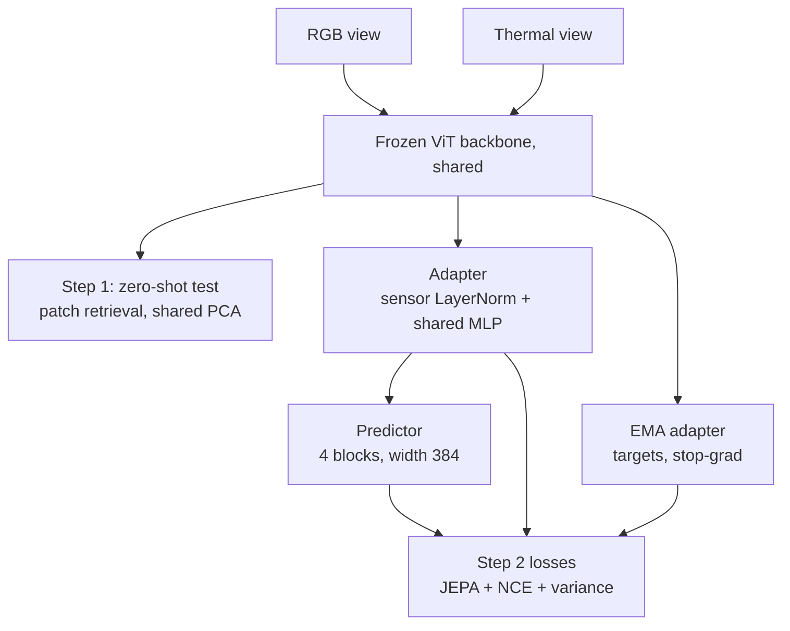
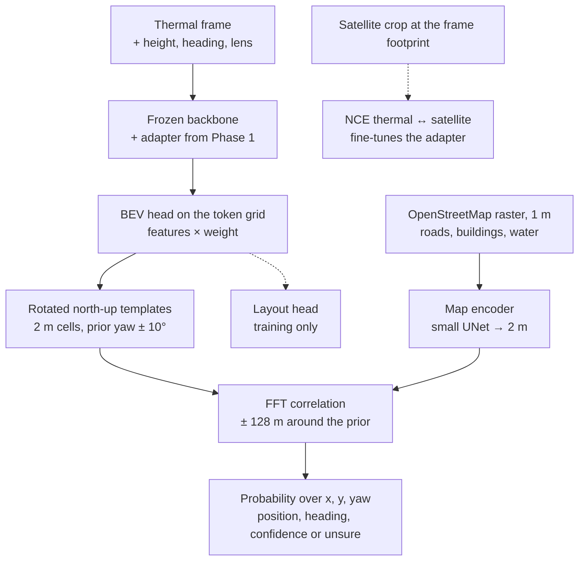

# StructGeo proof of concept — plan

## 0. Goal
| Phase | Question | Data | When |
|---|---|---|---|
| 1 | Do RGB and thermal drone images share structure in frozen self-supervised features, and does a small JEPA-trained adapter make that space shared? | METU-VisTIR | Step 1 result by Nov 14 (slide); step 2 by Nov 15 |
| 2 | Can a thermal frame be placed on OpenStreetMap from that shared space, with a confidence or "unsure"? | Thermal-UAV + OpenStreetMap | After Nov 17 |
| 3 | Does the same shared space hold with a third sensor (LiDAR)? | MultiFly (aerial) when released; MS2 (ground) now | After Phase 2 |

The backbone stays frozen (option A). Only the adapter, predictor and, in Phase 2, the map side are trained. "JEPA-based" refers to our training objective: predict another sensor's (later the map's) structure in feature space.

---

## 1. Data

### 1.1 Phase 1: METU-VisTIR
- Drone RGB (3840×2160, 84° diagonal FOV) and thermal (640×512, 61°), shot together on one gimbal; cloudy and sunny scenes.
- Each index entry is one shot: `image_paths[i] = (visible, thermal)`, `intrinsics[i] = (K_v, K_t)`, `distortion_coefs[i]`, and **one pose per entry** (the two cameras share it).
- After undistortion (`getOptimalNewCameraMatrix`, alpha 0, as XoFTR does), the RGB→thermal map is a pure-intrinsics homography `H = K'_t · K'_v⁻¹`. `prep_metu.py` takes the median over all shots and reports its spread.
- Split **by scene**: both conditions of a test scene go to test. Default test scenes: one with cloudy + sunny, one cloudy-only (set after download).
- License: CC BY-NC-SA 4.0.

### 1.2 Phase 2: Thermal-UAV + OpenStreetMap
- Thermal-UAV: 11,890 straight-down thermal frames (DJI Matrice 4T, 1280×1024, 12 mm lens, 9.83 mm sensor diagonal, 35.4° horizontal FOV) around Changsha, day and night, continuous flights; split 8,115 / 1,425 / 2,350. Hugging Face `FloralHercules/Thermal-UAV`; tools in `FloralHercules/SCC-Loc`.
- Per frame (metadata JSON, or the per-scene `Thermal_info.csv`): drone lat/lon, laser-target lat/lon (`TargetLatitude/Longitude`, the ground point at the image center), laser range (`rel_height`), gimbal pitch and roll, flight yaw (`yaw`). Scene folders carry day/night in their name (e.g. `city_300_ortho_night`).
- Reference: Google satellite 0.26 m/px (`ref.tif`) and DSM 5.29 m/px, UTM 49N. We use the satellite only to render "satellite crops" at each frame's footprint (training pairs and the m2 test); the map we match against is OpenStreetMap.
- OpenStreetMap roads, buildings and water for the `ref.tif` box (Overpass or a Geofabrik extract); Overture buildings or DSM buildings if OSM buildings are thin.
- Checks before Phase 2: the Thermal-UAV data license; OSM building coverage around Changsha (`p2_osm.py` prints it).

### 1.3 Three sensors: RGB + thermal + LiDAR (after Phase 2)
| Dataset | Platform | Sensors | Status (Nov 12) | Fit |
|---|---|---|---|---|
| **MultiFly** (arXiv 2610.10359, Oct 2026) | UAV, low altitude; 4 suburban scenes, 2 altitudes | RGB, thermal, LiDAR, radar; time-synchronized, calibrated; GNSS-RTK/IMU; 17,272 samples; labels for 15 classes in all four modalities | `github.com/markus-42/multifly`; data and code listed as "coming soon" | **First choice**: aerial, all three sensors, calibrated, with position |
| MS2 (CVPR 2023) | Car | Stereo RGB, stereo NIR, stereo thermal, LiDAR, GNSS/IMU | Public, CC BY-NC-SA | Fallback now: ground level |
| FIReStereo (RA-L 2025) | Small UAS | Stereo thermal, LiDAR, IMU (no RGB) | Public | Aerial, but thermal + LiDAR only |
| Caltech Aerial RGB-T (ECCV 2024) | UAV | RGB, thermal, GPS, IMU (no LiDAR) | Public | Aerial, but RGB + thermal only |

Suggested order: start the three-sensor test on MS2 now and switch to MultiFly when its data is out. With MS2 the views are forward-looking from a car, so placing them on a 2D map needs a ground-plane (bird's-eye) projection first: an open research question for the project, not a blocker for the shared-space test. See §9.

---

## 2. Phase 1 network



### 2.1 Backbones (frozen)
| | I-JEPA | DINOv3 web | DINOv3 SAT |
|---|---|---|---|
| Checkpoint | ViT-H/16, 448 px, ImageNet-1K | ViT-L/16, LVD-1689M | ViT-L/16, SAT-493M |
| Weights used | `target_encoder` for full images, `encoder` for masked context | same model for both | same model for both |
| Feature dim | 1280 | 1024 | 1024 |
| Positions | fixed 28×28 table, bicubic-resized to the token grid | RoPE, any grid | RoPE, any grid |
| Normalization | ImageNet | ImageNet | satellite mean/std |
| Role | Trained runs + zero-shot | Trained runs + zero-shot | Zero-shot only (its real test is Phase 2) |

All use patch 16. Features: last layer after the final norm; ablation: mean of the last 4 layers.

### 2.2 Two resolution options
| | Same resolution | Native resolution |
|---|---|---|
| RGB input | Warped into the thermal frame with H, 640×512 | Resized to 992×560, so one RGB token covers about the same angle as one thermal token |
| Thermal input | 640×512, 1–99% stretch, 3 channels | same |
| Token grids | 40×32 and 40×32 | RGB 62×35, thermal 40×32 |
| Token positions | Shared grid | Every token center mapped into thermal pixel coordinates (u, v) through H |
| Same-spot RGB feature | Same index | Bilinear sample of the RGB token map at H⁻¹ of the thermal token center |
| RGB outside the thermal view | Cut | Kept as extra context |

### 2.3 Trained parts
| Part | Design | Size |
|---|---|---|
| Adapter | Per-sensor LayerNorm(D) → shared Linear(D, 512) → GELU → Linear(512, 256). No sensor embedding on the output, so z stays comparable across sensors | ~0.7–0.8M |
| Predictor | Linear(256, 384) on context tokens; mask tokens as queries; 2D sin-cos encoding of continuous (u, v); a learned sensor embedding on context and queries; 4 pre-norm transformer blocks, 6 heads; Linear(384, 256) on the queries | ~7M |
| EMA adapter | Copy of the adapter, momentum 0.996 → 1.0 | — |

---

## 3. Masking
1. **Leak fix (both options).** Frozen ViT tokens see the whole image, so hiding tokens after the backbone hides nothing. The context sensor is masked at the **backbone input**: I-JEPA drops hidden tokens; DINOv3 puts its learned mask token at hidden patches. Targets are full-image features of the other sensor (cached), as in I-JEPA.
2. **Blocks in one physical frame.** 4 target blocks per sample, each 10–20% of the thermal frame, aspect 0.75–1.5, drawn in thermal pixel coordinates (always inside both views).
3. **Targets:** tokens of the target sensor whose center falls inside a block.
4. **Hidden context:** tokens of the context sensor whose footprint touches a block grown by 16 px.
5. Both directions every step (RGB→thermal, thermal→RGB). One mask set per batch.

---

## 4. Losses
**L = 1.0·L_JEPA + 1.0·L_NCE + 0.1·L_var**

| Term | What |
|---|---|
| L_JEPA | Smooth-L1 between predicted target tokens and LayerNorm'd EMA-adapter tokens of the other sensor, averaged over both directions |
| L_NCE | Patch InfoNCE between thermal z and same-spot RGB z; 64 anchors per pair; negatives are other spots in the pair (excluding the 8 neighbors) and all spots of the other pairs in the batch; τ = 0.07; symmetric |
| L_var | Hinge on per-dimension std of z (both sensors), against collapse |

Why both JEPA and NCE: with JEPA alone, the predictor can absorb the sensor gap and z never becomes shared, yet z is what Phase 2 warps and matches against the map. NCE aligns z directly; JEPA keeps "structure from partial views".

---

## 5. Training
```
optimizer   AdamW, lr 1e-3, weight decay 0.05, 5% warmup, cosine
batch       64 pairs, 100 epochs
EMA         0.996 → 1.0, linear
precision   bf16 autocast; backbone frozen, no backward through it
cost        ~1–2 h per run on one H100 (two masked backbone passes per step)
```

---

## 6. Evaluation (test scenes)
- **hit@1:** for each interior thermal token, the most similar RGB token (by cosine) is a hit if it is within 1 token of the true spot. Also RGB→thermal. Chance ≈ 0.8%.
- **Median rank** of the true spot, both directions.
- Reported overall and per condition (cloudy, sunny).
- **Baselines:** raw pixel patches and HOG, same-resolution option only.
- **Figures:** shared PCA (one basis for both sensors), so the same color means the same feature.

---

## 7. Run matrix
| Group | Runs |
|---|---|
| Step 1, zero-shot | {I-JEPA, DINOv3 web, DINOv3 SAT} × {same, native} + pixels + HOG |
| Step 2, main | r1 I-JEPA/same · r2 I-JEPA/native · r3 DINOv3/same · r4 DINOv3/native |
| Ablations (best of r1–r4) | a1 JEPA only · a2 NCE only · a3 mean of last 4 layers |

---

## 8. Phase 2: thermal frame → OpenStreetMap


### 8.1 Geometry from metadata (straight-down frames)
| Item | How |
|---|---|
| Image-center ground point | Laser target lat/lon, else drone lat/lon; projected to the map CRS (UTM 49N) |
| Height above ground | Laser range, rolling median of 31 frames along each flight (one laser hit on a roof would shrink the scale) |
| Ground resolution | height × pixel pitch / focal length; pixel pitch = sensor diagonal / image diagonal |
| Heading | Flight yaw, clockwise from north; image up = heading |
| Frames kept | Within 10° of straight down |

### 8.2 Matcher
| Item | Setting |
|---|---|
| Position prior | Uniform ±100 m per axis (training: new each step; evaluation: fixed per frame in `frames.json`) |
| Heading prior | ±5° error; search ±10° in 2° steps (11 bins) |
| Template | 128 × 128 cells of 2 m (256 m; holds the ~245 m footprint diagonal at 300 m) |
| Search | 129 × 129 positions (±128 m), all yaw bins at once, by FFT correlation |
| Output | Softmax over (yaw, y, x) with a learned scale → position, heading; confidence = probability mass within 10 m of the peak; "unsure" below τ |
| τ | Set on validation for 95% precision at ≤ 25 m |

### 8.3 Trained parts and losses
| Part | Design |
|---|---|
| Adapter | From Phase 1 (same backbone and layers), fine-tuned at lr 1e-4 |
| BEV head | 2 × conv 3×3 (256 → 128) on the token grid → 32-d matching features × a sigmoid weight per cell, plus 5 layout logits |
| Map encoder | 4-level UNet on 5 binary channels (major road, minor road, building, building edge, water) at 1 m → 32-d at 2 m |
| Losses | NLL of the true (yaw, y, x) + layout (BCE + Dice against OSM rendered into the camera frame) + 0.5·NCE (thermal ↔ satellite crop, same tokens) + 0.1·variance; JEPA (as Phase 1, thermal ↔ satellite crop) in a2 |
| Training | AdamW 3e-4, 30 epochs, batch 16, cosine; ±5% ground-resolution jitter |

### 8.4 Runs
| Run | Trained on | Adapter | Question |
|---|---|---|---|
| m1 | Thermal frames | Phase 1, fine-tuned + NCE | Main result |
| m2 | Satellite crops only | Phase 1, frozen | **Key test:** a matcher that never saw a thermal frame, tested on thermal |
| m3 | Thermal frames | Random | What Phase 1 adds |
| a1 | Thermal frames | As m1 | Without the layout loss |
| a2 | Thermal frames | As m1 + JEPA | Masked cross-sensor prediction here too |
| m4 (optional) | Drone RGB frames | As m1 | RGB vs. thermal, day vs. night |

Every run is tested on thermal frames and satellite crops (m4 on drone RGB).

### 8.5 Checks before training (`p2_check.py`)
1. **Geometry:** the satellite rendered at the metadata pose must match the frame (edge correlation) better than a flipped yaw sign, a 180° turn, +15°, ±15% scale and a 20 m shift. If not, it says which setting to change.
2. **Matcher code:** OSM rendered from the true pose must be found again (median about one cell).
3. **Map content** per footprint (map-limited frames), and the **prior-only error**, the floor any method must beat.

### 8.6 Metrics
Median and mean error (m); % within 5 / 10 / 25 / 50 m; heading error; AUROC of the confidence for error ≤ 25 m; coverage and precision at τ; day vs. night; prior-only error. Reference: the published satellite-image baseline on the same test split (mean error 9.37 m; satellite + DSM, a different map source).

---

## 9. Three sensors (after Phase 2)
- **Input:** LiDAR projected into the thermal camera with the calibration → a 3-channel image (height above ground, intensity, point density), on the same token grid.
- **Network:** a third adapter branch (per-sensor LayerNorm) or a small trainable LiDAR encoder → the same 256-d space; the predictor gets a third sensor embedding.
- **Losses:** JEPA in all six directions (context from one sensor predicts another's hidden tokens); NCE over the three pairs.
- **Tests:** Phase 1 retrieval for each pair; leave-one-sensor-out (train on two pairs, test the third).
- **Map link:** from the air (MultiFly), LiDAR height edges line up with building outlines, the map layer we match. From the ground (MS2), a bird's-eye projection comes first (open question).

---

## 10. Timeline
| Day | Work |
|---|---|
| Nov 12 | Download METU-VisTIR and I-JEPA; `prep_metu.py`; check `meta.json`; start caching |
| Nov 13 | Zero-shot rows (step 1) → best PCA figure for slide 3 |
| Nov 14 | Main runs r1–r4 |
| Nov 15 | Ablations a1–a3; final figure |
| Nov 16 | Slides due |
| After Nov 17 | Phase 2: download Thermal-UAV + OSM; `p2_prep`, `p2_osm`, `p2_cache`; `p2_check` must pass |
| Then | Runs m1–m3, ablations a1–a2; three-sensor loader (MS2 now, MultiFly when released) |

---

## 11. Risks and checks
| Risk | Check / fix |
|---|---|
| A visible/thermal entry is not the same shot | `n_name_mismatch` in `meta.json` must be 0; look at a few pairs |
| One H is not enough (autofocus changes K) | `H_spread_px_p95` should be < 16 px; if not, switch to per-pair H |
| DINOv3 checkpoint format | Use Meta's `.pth` checkpoints; the satellite model layout is picked from the config key `dino_sat` |
| Disk | Images ~3.6 MB/pair; features ~30 MB/pair for all backbones and options |
| Thermal looks too different for frozen features | That is a result too: report it, and rely on step 2 |
| Thin OSM buildings around Changsha | `p2_osm.py` prints coverage; add Overture buildings or DSM buildings |
| Heading convention (flight yaw vs. image up) | `p2_check.py` geometry test; `yaw_sign` / `yaw_offset` |
| Laser range hits a roof → wrong scale | Rolling median along the flight; ±5% scale jitter in training |
| Phase 2 disk | ~31 GB of features per query kind (DINOv3 ViT-L, 640×512); thermal + satellite ≈ 62 GB |
| MultiFly not released in time | Run the three-sensor test on MS2 first |
