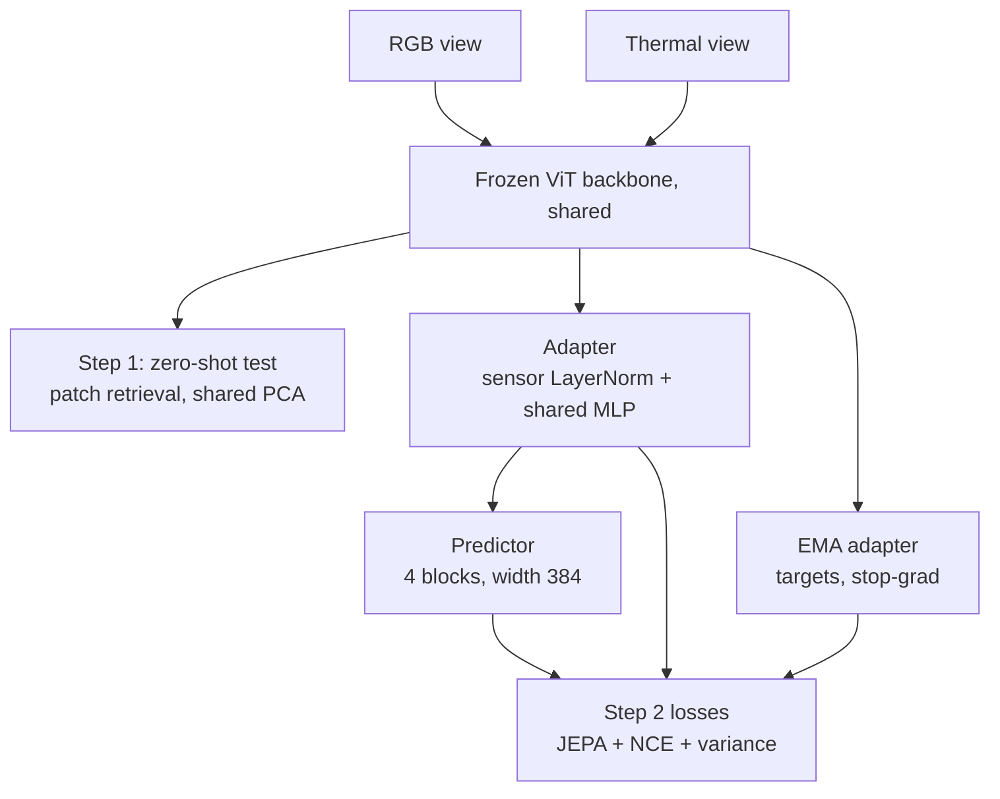
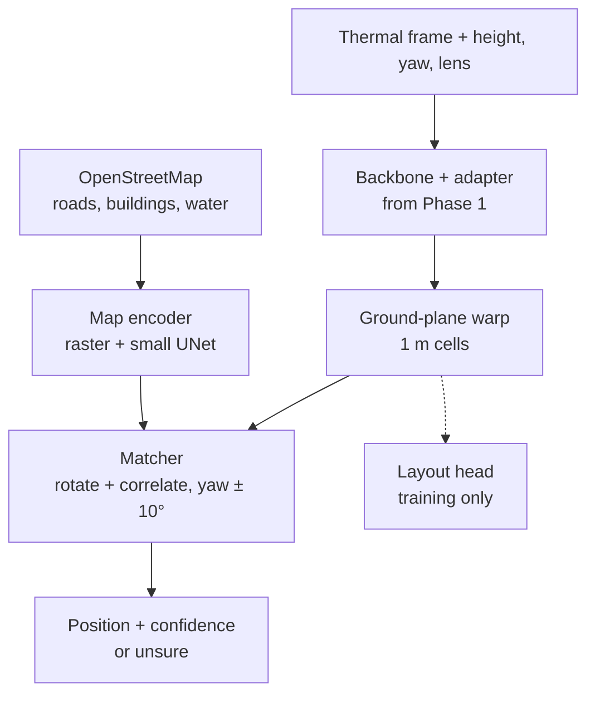

# StructGeo proof of concept — plan

## 0. Goal
| Phase | Question | Data | When |
|---|---|---|---|
| 1 | Do RGB and thermal drone images share structure in frozen self-supervised features, and does a small JEPA-trained adapter make that space shared? | METU-VisTIR | Step 1 result by Nov 14 (slide); step 2 by Nov 15 |
| 2 | Can a thermal frame be placed on OpenStreetMap from that shared space, with a confidence or "unsure"? | Thermal-UAV + OpenStreetMap | After Nov 17 |

The backbone stays frozen (option A). Only the adapter, predictor and, in Phase 2, the map side are trained. "JEPA-based" refers to our training objective: predict another sensor's (later the map's) structure in feature space.

---

## 1. Data

### 1.1 Phase 1: METU-VisTIR
- Drone RGB (3840×2160, 84° diagonal FOV) and thermal (640×512, 61°), shot together on one gimbal; cloudy and sunny scenes.
- Each index entry is one shot: `image_paths[i] = (visible, thermal)`, `intrinsics[i] = (K_v, K_t)`, `distortion_coefs[i]`, and **one pose per entry** (the two cameras share it).
- After undistortion (`getOptimalNewCameraMatrix`, alpha 0, as XoFTR does), the RGB→thermal map is a pure-intrinsics homography `H = K'_t · K'_v⁻¹`. `prep_metu.py` takes the median over all shots and reports its spread.
- Split **by scene**: both conditions of a test scene go to test. Default test scenes: one with cloudy + sunny, one cloudy-only (set after download).
- License: CC BY-NC-SA 4.0.

### 1.2 Phase 2: Thermal-UAV + OpenStreetMap
- Thermal-UAV: 11,890 straight-down thermal frames (DJI Matrice 4T, Changsha), day and night, split 8,115 / 1,425 / 2,350. Per frame: lat/lon, rangefinder height, yaw/pitch/roll, sensor and lens data. Satellite map 0.26 m/px + DSM, UTM 49N. Hugging Face `FloralHercules/Thermal-UAV`; tools in `FloralHercules/SCC-Loc`.
- OpenStreetMap roads, buildings and water for the `ref.tif` area (Overpass); Overture buildings if OSM buildings are thin.
- Checks before Phase 2: the Thermal-UAV data license; OSM building coverage around Changsha.

---

## 2. Phase 1 network



### 2.1 Backbones (frozen)
| | I-JEPA | DINOv3 web | DINOv3 SAT |
|---|---|---|---|
| Checkpoint | ViT-H/16, 448 px, ImageNet-1K | ViT-L/16, LVD-1689M | ViT-L/16, SAT-493M |
| Weights used | `target_encoder` for full images, `encoder` for masked context | same model for both | same model for both |
| Feature dim | 1280 | 1024 | 1024 |
| Positions | fixed 28×28 table, bicubic-resized to the token grid | RoPE, any grid | RoPE, any grid |
| Normalization | ImageNet | ImageNet | satellite mean/std |
| Role | Trained runs + zero-shot | Trained runs + zero-shot | Zero-shot only (its real test is Phase 2) |

All use patch 16. Features: last layer after the final norm; ablation: mean of the last 4 layers.

### 2.2 Two resolution options
| | Same resolution | Native resolution |
|---|---|---|
| RGB input | Warped into the thermal frame with H, 640×512 | Resized to 992×560, so one RGB token covers about the same angle as one thermal token |
| Thermal input | 640×512, 1–99% stretch, 3 channels | same |
| Token grids | 40×32 and 40×32 | RGB 62×35, thermal 40×32 |
| Token positions | Shared grid | Every token center mapped into thermal pixel coordinates (u, v) through H |
| Same-spot RGB feature | Same index | Bilinear sample of the RGB token map at H⁻¹ of the thermal token center |
| RGB outside the thermal view | Cut | Kept as extra context |

### 2.3 Trained parts
| Part | Design | Size |
|---|---|---|
| Adapter | Per-sensor LayerNorm(D) → shared Linear(D, 512) → GELU → Linear(512, 256). No sensor embedding on the output, so z stays comparable across sensors | ~0.7–0.8M |
| Predictor | Linear(256, 384) on context tokens; mask tokens as queries; 2D sin-cos encoding of continuous (u, v); a learned sensor embedding on context and queries; 4 pre-norm transformer blocks, 6 heads; Linear(384, 256) on the queries | ~7M |
| EMA adapter | Copy of the adapter, momentum 0.996 → 1.0 | — |

---

## 3. Masking
1. **Leak fix (both options).** Frozen ViT tokens see the whole image, so hiding tokens after the backbone hides nothing. The context sensor is masked at the **backbone input**: I-JEPA drops hidden tokens; DINOv3 puts its learned mask token at hidden patches. Targets are full-image features of the other sensor (cached), as in I-JEPA.
2. **Blocks in one physical frame.** 4 target blocks per sample, each 10–20% of the thermal frame, aspect 0.75–1.5, drawn in thermal pixel coordinates (always inside both views).
3. **Targets:** tokens of the target sensor whose center falls inside a block.
4. **Hidden context:** tokens of the context sensor whose footprint touches a block grown by 16 px.
5. Both directions every step (RGB→thermal, thermal→RGB). One mask set per batch.

---

## 4. Losses
**L = 1.0·L_JEPA + 1.0·L_NCE + 0.1·L_var**

| Term | What |
|---|---|
| L_JEPA | Smooth-L1 between predicted target tokens and LayerNorm'd EMA-adapter tokens of the other sensor, averaged over both directions |
| L_NCE | Patch InfoNCE between thermal z and same-spot RGB z; 64 anchors per pair; negatives are other spots in the pair (excluding the 8 neighbors) and all spots of the other pairs in the batch; τ = 0.07; symmetric |
| L_var | Hinge on per-dimension std of z (both sensors), against collapse |

Why both JEPA and NCE: with JEPA alone, the predictor can absorb the sensor gap and z never becomes shared, yet z is what Phase 2 warps and matches against the map. NCE aligns z directly; JEPA keeps "structure from partial views".

---

## 5. Training
```
optimizer   AdamW, lr 1e-3, weight decay 0.05, 5% warmup, cosine
batch       64 pairs, 100 epochs
EMA         0.996 → 1.0, linear
precision   bf16 autocast; backbone frozen, no backward through it
cost        ~1–2 h per run on one H100 (two masked backbone passes per step)
```

---

## 6. Evaluation (test scenes)
- **hit@1:** for each interior thermal token, the most similar RGB token (by cosine) is a hit if it is within 1 token of the true spot. Also RGB→thermal. Chance ≈ 0.8%.
- **Median rank** of the true spot, both directions.
- Reported overall and per condition (cloudy, sunny).
- **Baselines:** raw pixel patches and HOG, same-resolution option only.
- **Figures:** shared PCA (one basis for both sensors), so the same color means the same feature.

---

## 7. Run matrix
| Group | Runs |
|---|---|
| Step 1, zero-shot | {I-JEPA, DINOv3 web, DINOv3 SAT} × {same, native} + pixels + HOG |
| Step 2, main | r1 I-JEPA/same · r2 I-JEPA/native · r3 DINOv3/same · r4 DINOv3/native |
| Ablations (best of r1–r4) | a1 JEPA only · a2 NCE only · a3 mean of last 4 layers |

---

## 8. Phase 2 extension


| Kept from Phase 1 | New in Phase 2 |
|---|---|
| Backbone wrapper, adapter (fine-tuned), masking and JEPA code, retrieval metric | Footprint from metadata: pixel pitch = sensor diagonal / image diagonal; ground resolution = height × pitch / focal; rotation from yaw |
| | JEPA pairs become satellite crop at the true footprint ↔ thermal frame |
| | OSM rasterized at 1 m (major road, minor road, building fill, building edge, water, intersections) → small UNet → 256-d |
| | Matcher: FFT correlation over a 600 × 600 m window × yaw ± 10° (1° steps) → softmax with a learned temperature |
| | Loss: NLL of the true (x, y, θ) + layout loss (CE + Dice) + JEPA |
| | Confidence: probability mass within 10 m of the peak; "unsure" below τ set on validation |

**Phase 2 metrics:** median and mean error (m); % within 5 / 10 / 25 m; heading error; coverage vs. precision for "unsure"; AUROC of confidence for error > 25 m; day vs. night. Reference: the published SCC-Loc baseline on the same test split (satellite imagery, mean error 9.37 m). Key test: train on satellite RGB crops only, test on thermal.

---

## 9. Timeline
| Day | Work |
|---|---|
| Nov 12 | Download METU-VisTIR and I-JEPA; `prep_metu.py`; check `meta.json`; start caching |
| Nov 13 | Zero-shot rows (step 1) → best PCA figure for slide 3 |
| Nov 14 | Main runs r1–r4 |
| Nov 15 | Ablations a1–a3; final figure |
| Nov 16 | Slides due |
| After Nov 17 | Phase 2 data prep, then Phase 2 |

---

## 10. Risks and checks
| Risk | Check / fix |
|---|---|
| A visible/thermal entry is not the same shot | `n_name_mismatch` in `meta.json` must be 0; look at a few pairs |
| One H is not enough (autofocus changes K) | `H_spread_px_p95` should be < 16 px; if not, switch to per-pair H |
| DINOv3 checkpoint format | Use Meta's `.pth` checkpoints; the satellite model layout is picked from the config key `dino_sat` |
| Disk | Images ~3.6 MB/pair; features ~30 MB/pair for all backbones and options |
| Thermal looks too different for frozen features | That is a result too: report it, and rely on step 2 |
